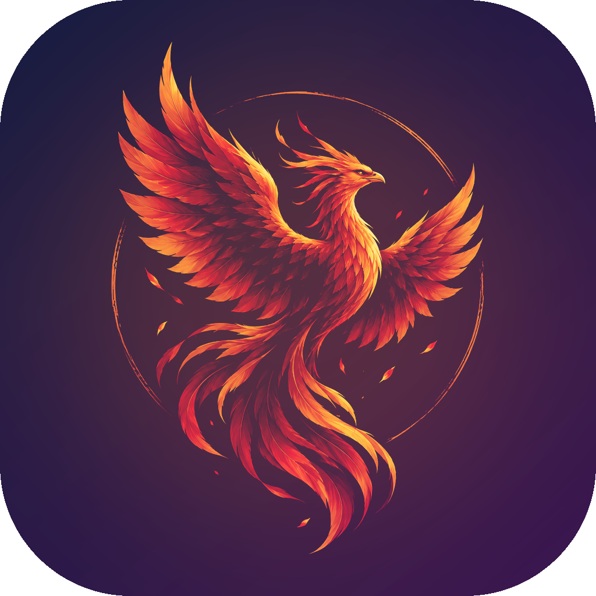

<div align="center">



# Aghelan Ghiamat · عاقلان قیامت

Open-source VPN client for **Android** and **Windows**, powered by the
[sing-box](https://github.com/SagerNet/sing-box) core.

*The phoenix rises from its ashes: freedom to reach the whole internet.*

[فارسی](#فارسی) · [English](#english)

</div>

---

## English

### Features

- **Protocols:** VMess, VLESS (incl. REALITY + XTLS-Vision), Trojan,
  Shadowsocks (SIP002, 2022 ciphers, legacy, obfs/v2ray plugins), Hysteria2
  (incl. port hopping), TUIC, WireGuard, SSH — plus Hysteria v1, AnyTLS and
  SOCKS.
- **OpenVPN, Cisco AnyConnect and Outline:** `.ovpn` profiles with their
  certificates inside (UDP/TCP, several servers, tls-auth, tls-crypt,
  tls-crypt-v2, username/password asked for when the file has none, through
  an `http-proxy` or `socks-proxy` with its login inside the file); Cisco
  AnyConnect / ocserv servers from address + login (a self-signed
  certificate is shown and pinned once you trust it); Outline dynamic access
  keys (`ssconf://`), refreshed like subscriptions. These run on sing-box's
  own OpenVPN/OpenConnect clients and add about 2 MB to the APK.
- **Transports:** TCP, WebSocket (with early data), gRPC, HTTP/2, HTTPUpgrade,
  QUIC, TCP+HTTP header obfuscation.
- **XHTTP, mKCP and VLESS Encryption (bundled Xray engine):** the core is
  sing-box plus an `xray` outbound (`core/xray`) built on Xray-core. Configs
  only Xray can run (xhttp/splithttp, mKCP incl. old header/seed configs,
  VLESS Encryption, Xray JSON configs) go through it; sing-box still does
  TUN, routing, DNS, tests and auto mode, and dials every socket Xray opens.
  Xray no longer accepts `allowInsecure`, so those configs verify the server
  certificate (`pcs` pins a self-signed one).
- **Import from anywhere:** share links, clipboard, camera QR (Android), QR
  from an image/screenshot (Android + Windows), pasted text, subscription URLs
  (base64 or plain), sing-box/Xray JSON, and files (`.ovpn` and the rest,
  also opened or shared from Telegram and file managers on Android).
- **Subscriptions:** quota/expiry from `subscription-userinfo`, panel titles,
  one-tap update that keeps your selected server.
- **Full-device tunnel:** Android `VpnService` via libbox; Windows TUN
  (wintun) via `sing-box.exe` with admin rights, tray icon and close-to-tray.
- **Live stats:** connection timer and upload/download speed and totals from
  the core's Clash API.
- **Real latency test:** tests every server through the proxy itself (an
  HTTPS request timed by a separate sing-box test core, so it works with or
  without the VPN on), shows per-server ms badges, sorts fastest first, and
  skips configs the core rejects instead of failing the whole run.
- **Download speed test:** per server (its menu) or per subscription
  (skipping servers the latency test found dead). Each server is exposed by
  the test core as its own local proxy and measured one at a time for up to
  10 s; results in Mbps stay on the server tiles. Latency and speed runs take
  turns on the test core instead of stopping each other.
- **Per-app proxy (Android):** all apps, only selected apps, or every app
  except the selected ones go through the VPN.
- **Clean CDN IP finder (Cloudflare or ArvanCloud):** for configs served
  through a CDN (ws/gRPC/HTTPUpgrade), scans a sample of the CDN's addresses
  from your own connection (TLS with the config's SNI, then `/cdn-cgi/trace`
  on Cloudflare or any HTTP answer on ArvanCloud) and makes a copy of the
  config pointed at the address you pick. ArvanCloud's edges are in Iran, so
  they often keep working on the national internet.
- **For the national internet** (only Iranian sites reachable):
  - **Detection:** with the VPN off, the app checks a few foreign and Iranian
    addresses (at start, on return to the app, after a failed connection) and
    shows a banner with what still works.
  - **DNS fallback:** while it lasts, a foreign direct DNS gives way to the
    system's own (domestic) resolver, so server names still resolve. The
    setting itself is not changed.
  - **Chaining (“Connect through another server”):** a config's menu can put
    it behind another config, e.g. a server in an Iranian data centre that
    still reaches abroad. The chain is a new config; up to three hops.
  - **Share the app offline:** Settings → “Share the app” sends the
    installed APK by Bluetooth, Nearby Share or a messenger (on Windows it
    opens the app folder to copy).
- **Usage statistics:** today / 7 days / 30 days, a 14-day chart and a daily
  table, counted from the core's own totals (so traffic while the app was
  closed is included).
- **Android quick settings tile and home screen widget** to connect with the
  last used config or disconnect.
- **Subscriptions update themselves** when the app opens (every 3–24 h, or off).
- **DNS presets** (Cloudflare, Google, Quad9, AdGuard; Shecan, Electro, Radar
  for direct lookups) besides typing any DoH/DoT/DoQ/UDP server.
- **Persian calendar:** dates are shown in the Solar Hijri calendar in Persian.
- **Auto mode (fastest server + failover):** picks the fastest servers from
  recent latency results (testing first if they are missing or older than an
  hour) and hands up to 10 of them to the core as a `urltest` group. The core
  re-tests them every minute and moves to another server when the current one
  stops answering; the home screen shows which server is in use.
- **Iranian sites without VPN (on by default):** `.ir` domains, well-known
  Iranian services and every IP range RIPE has delegated to Iran go direct and
  are resolved by the direct DNS. Faster, saves VPN traffic, and Iranian banks
  and government sites that block foreign IPs keep working. The ranges are
  built into the app (no download at connect time); refresh them with
  `python3 scripts/update_iran_ip_ranges.py`.
- **Anti-filtering options:** TLS fragment (*Light* splits the ClientHello
  into several TLS records, *Strong* into separate TCP segments) so simple SNI
  filters cannot read the server name, and Mux (h2mux/smux/yamux) for
  VMess/VLESS/Trojan/Shadowsocks servers that support it. Both are applied to
  every server that does not set them itself, latency tests included.
- **Faster video and apps (on by default):** QUIC (UDP 443) is not sent
  through the proxy, so YouTube, Instagram and browsers fall back to TCP right
  away. QUIC tunnelled over a TCP-based proxy (and REALITY/Vision servers that
  drop it) is the usual reason a VPN feels slow on video. VLESS/VMess UDP uses
  XUDP by default, like Xray clients.
- **Security:** speed-test proxies and the optional local proxy port need a
  password (other apps on the device cannot use them or learn your server);
  configs that skip certificate checks carry an "Insecure" badge; Android's
  Always-on + "block connections without VPN" (kill switch) can be checked
  and opened from the settings; a core that dies mid-connection is
  restarted once.
- **Smart setup per network:** tests TLS fragment modes with your servers on
  the current internet, applies the best and remembers it per mobile
  operator (MCI, Irancell, RighTel, ...) or Wi-Fi; used again on connect.
- **Free config (one tap):** the button at the top of the home screen uses
  Cloudflare's free WARP: it registers a WARP device once, tries WARP
  addresses and ports on the current internet, keeps the fastest and
  connects. The route is remembered per operator (MCI, Irancell, RighTel,
  Wi-Fi), so on another SIM the free config switches to the route found
  there; a route that stopped working is replaced by a new search.
- **Backup and restore** of all configs, subscriptions and settings as one
  file; **links from other apps** (vless://..., subscription pages'
  sing-box:// / v2rayng:// / hiddify:// import links, "Share" to the app);
  a **logs page** for the core.
- **Updates:** one release key for every build (so updates install over
  the old app), GitHub releases on tags and an in-app update check.
- **Liquid Glass design:** frosted glass panels with lit rims over an aurora
  backdrop that warms up while connected, a floating glass tab bar (a side
  rail on wide windows) and the phoenix as the connect button: wings folded
  and ash grey when off, spreading open and flapping as it catches fire while
  the tunnel comes up.
- **Persian + English** with full right-to-left layout, light/dark themes,
  bundled Vazirmatn font.
- **Connection settings:** remote/direct DNS (DoH, DoT, DoQ, UDP, system),
  IPv6, uTLS fingerprint, TUN stack, local HTTP/SOCKS port, log level.
- **No proprietary SDKs:** QR scanning uses the official camera plugin and a
  pure-Dart decoder (no Google ML Kit), so the app is F-Droid friendly.

### Project layout

```
lib/
  core/
    singbox/          share-link + subscription parsers, sing-box config builder
    theme/ utils/ widgets/ storage/ constants/
  features/
    home/             connect button, status, speeds
    profiles/         configs, subscriptions, import flows, QR scanner
    connection/       VPN state, Android/Windows platforms, Clash API client
    settings/         language, theme, connection options
    desktop/          Windows tray + window behaviour
  l10n/               app_en.arb, app_fa.arb (+ generated code)
android/app/src/main/kotlin/com/aghelan/ghiamat/vpn/
                      VpnService + libbox PlatformInterface, Flutter bridge
windows/              runner (admin manifest, single instance), core/sing-box.exe
core/xray/            the "xray" sing-box outbound (Go), patched into the core build
scripts/              build the core (sing-box + Xray); app icon (make_icon.py), animated
                      phoenix (make_phoenix.py) and the mono mark (make_brand.py)
test/                 unit, widget and real-core integration tests
```

State management is [Riverpod 3](https://riverpod.dev). The sing-box version
is pinned in `scripts/core_version.txt` (currently **1.14.3**), and the build
refuses a source tree whose commit differs from `scripts/core_commit.txt`
(update both together).

### Requirements

| Tool | Version |
|------|---------|
| Flutter | 3.47.x (stable) |
| Go | 1.25+ (the core is built from source) |
| JDK | 17+ |
| Android SDK + NDK | platform 36, NDK 28.2.13676358 |
| Windows | Windows 10/11 x64, Visual Studio 2022 with "Desktop development with C++" |

### Build for Android

`scripts/build_libbox.sh` is a bash script: on a Windows machine run it from
WSL or Git Bash (or let CI build it, see below).

```bash
# 1. Build the core for Android (libbox.aar: sing-box + the Xray engine,
#    ~10–20 min the first time)
export ANDROID_HOME=$HOME/Android/Sdk          # your SDK path
sdkmanager "ndk;28.2.13676358"
scripts/build_libbox.sh                         # -> android/app/libs/libbox.aar
#   only arm64 (faster, for testing):  scripts/build_libbox.sh android/arm64

# 2. Build the app
flutter pub get
flutter build apk --release --split-per-abi     # -> build/app/outputs/flutter-apk/
#   or run on a device:  flutter run
```

**Release signing:** CI signs with the key in the repository secrets
`ANDROID_KEYSTORE_BASE64` (the `.jks` file, base64) and
`ANDROID_KEYSTORE_PASSWORD` (store and key password, alias `aghelan`); keep
the same key forever, or users have to uninstall to update. Pushing a tag
such as `v0.2.0` publishes a GitHub release. Locally, create
`android/key.properties`

```properties
storeFile=/absolute/path/to/release.jks
storePassword=...
keyAlias=...
keyPassword=...
```

Without it, release builds are signed with the debug key.

A release APK for one ABI is about 30 MB (the sing-box core is ~20 MB of it).

### Build for Windows

Enable **Developer Mode** in Windows settings first (Flutter needs symlinks
for plugins). The core is built from source (the official sing-box release
has no Xray engine), with Go and Git Bash:

```powershell
# 1. Build sing-box.exe (sing-box + Xray) into windows\core\
bash scripts/build_core_windows.sh

# 2. Build
flutter pub get
flutter build windows --release
# Output: build\windows\x64\runner\Release\

# 3. Installer (Inno Setup 6): build\installer\aghelan-ghiamat-windows-x64-setup.exe
& "${env:ProgramFiles(x86)}\Inno Setup 6\ISCC.exe" /DAppVersion=0.2.0 windows\installer\aghelan-ghiamat.iss
```

Ship the **installer** (CI also offers a portable folder, for flash drives
and PCs where installing is not possible): it puts the app in Program Files, where only
administrators can change its files. The app runs as administrator, so run
from an unzipped folder any program could swap a DLL or the core and have it
run elevated. Configs stay in the user's profile across updates and
uninstalls.

The app requests administrator rights at launch (TUN needs them). Because of
that, `flutter run` must be started from an **elevated** terminal or IDE.
Closing the window minimises it to the tray; use the tray menu → *Quit* to exit
(which also stops the core).

### CI builds

`.github/workflows/build.yml` runs analysis and tests, builds the core and
validates every generated config with it (plus XHTTP/mKCP traffic through a
local Xray server), then builds the Android APKs and one Windows download
holding both the installer (installed and uninstalled once on the runner as a
check) and a portable folder. Push to `main` (or run the workflow
manually) and grab the files from the run's *Artifacts* section.

**Protecting the release key.** The Android job signs in a `release`
environment on main and `v*` tags (pull requests run without it). To keep the
key out of reach of anything else, in *Settings → Environments → release* set
*Deployment branches and tags* to `main` and the tag pattern `v*`, add
`ANDROID_KEYSTORE_BASE64` and `ANDROID_KEYSTORE_PASSWORD` there, and then
delete the repository-level secrets of the same names. A tag ruleset that only
lets admins create, move or delete `v*` tags completes it.

### Tests

```bash
flutter test                                              # unit + widget tests
scripts/build_core.sh linux amd64 build/core/sing-box   # the core with Xray
SING_BOX_BIN=build/core/sing-box flutter test --tags singbox  # validate configs with the real core
#   XRAY_BIN=/path/to/xray adds XHTTP/mKCP traffic through a local Xray server
SCREENSHOTS=1 flutter test test/screenshots               # render UI screenshots to build/screenshots
```

### Roadmap

Phase 2 is complete: latency and speed tests, auto mode with failover, Iran
routing, TLS fragment and Mux, per-app proxy, clean IP finder, usage
statistics, quick settings tile and widget, subscription auto-update, DNS
presets. Phase 3 added the Xray engine, smart per-network setup, WARP,
backup/restore, link import, logs, security hardening and release signing.

### License

GPL-3.0-or-later. sing-box is GPL-3.0-or-later; parts of the Android service
are adapted from [sing-box-for-android](https://github.com/SagerNet/sing-box-for-android)
(GPL-3.0). The Vazirmatn font is under the SIL Open Font License 1.1
(`assets/fonts/Vazirmatn-OFL.txt`).

---

<div dir="rtl">

## فارسی

### امکانات

- **پروتکل‌ها:** VMess، VLESS (همراه REALITY و XTLS-Vision)، Trojan،
  Shadowsocks (SIP002، رمزهای ۲۰۲۲، قالب قدیمی، پلاگین obfs و v2ray)،
  Hysteria2 (با port hopping)، TUIC، WireGuard، SSH و علاوه بر این‌ها
  Hysteria نسخه ۱، AnyTLS و SOCKS.
- **OpenVPN، سیسکو و Outline:** فایل‌های `.ovpn` که گواهی‌ها داخلشان است
  (UDP و TCP، چند سرور، tls-auth، tls-crypt، tls-crypt-v2؛ اگر نام کاربری و
  رمز در فایل نباشد پرسیده می‌شود؛ از پشت پروکسی `http-proxy` یا
  `socks-proxy` که رمزش داخل فایل باشد)، سرورهای Cisco AnyConnect / ocserv با
  آدرس و نام کاربری و رمز (گواهی خودامضا نشان داده می‌شود و بعد از تأیید شما
  ثابت می‌ماند) و کلیدهای Outline (`ssconf://`) که مثل سابسکریپشن به‌روز
  می‌شوند. حدود ۲ مگابایت به برنامه اضافه می‌کنند.
- **ترنسپورت‌ها:** TCP، WebSocket، gRPC، HTTP/2، HTTPUpgrade، QUIC و با
  موتور Xray: XHTTP، mKCP و VLESS Encryption.
- **وارد کردن از همه‌جا:** لینک اشتراک، کلیپ‌بورد، اسکن QR با دوربین
  (اندروید)، QR از روی عکس یا اسکرین‌شات (اندروید و ویندوز)، متن چسبانده‌شده،
  لینک سابسکریپشن (base64 یا متن ساده)، JSON سینگ‌باکس و Xray، و فایل
  (`.ovpn` و بقیه؛ در اندروید با «باز کردن با» یا «اشتراک‌گذاری» از تلگرام و
  فایل‌منیجر).
- **سابسکریپشن:** نمایش حجم مصرفی و تاریخ انقضا، به‌روزرسانی با یک لمس بدون
  از دست رفتن سرور انتخاب‌شده.
- **تونل کامل دستگاه:** در اندروید با VpnService و در ویندوز با حالت TUN
  (همراه آیکون سینی سیستم).
- **آمار زنده:** زمان اتصال و سرعت آپلود/دانلود.
- **تست پینگ واقعی:** همه‌ی سرورها از داخل خود پراکسی تست می‌شوند (چه VPN
  روشن باشد چه خاموش)، کنار هر سرور عدد پینگ نمایش داده می‌شود و می‌توان
  سرورها را از سریع‌ترین مرتب کرد.
- **تست سرعت دانلود:** برای هر سرور (از منوی سرور) یا همه‌ی سرورهای یک
  سابسکریپشن. سرعت به مگابیت بر ثانیه زیر هر سرور نمایش داده می‌شود.
- **انتخاب برنامه‌ها (Split Tunnel، اندروید):** همه‌ی برنامه‌ها، فقط
  برنامه‌های انتخاب‌شده، یا همه به‌جز انتخاب‌شده‌ها از VPN رد می‌شوند.
- **پیدا کردن IP تمیز CDN (کلودفلر یا ابرآروان):** برای کانفیگ‌هایی که از
  CDN رد می‌شوند، IPهای سالم را با اینترنت خودتان پیدا می‌کند و با یک لمس
  کانفیگ جدید می‌سازد. سرورهای ابرآروان داخل ایران‌اند و در اینترنت ملی هم
  اغلب کار می‌کنند.
- **برای اینترنت ملی** (وقتی فقط سایت‌های داخلی باز می‌شوند):
  - **تشخیص خودکار:** وقتی VPN خاموش است، برنامه چند آدرس خارجی و داخلی را
    امتحان می‌کند (هنگام باز شدن، برگشت به برنامه و بعد از وصل نشدن) و
    بنری نشان می‌دهد که چه چیزهایی هنوز کار می‌کند.
  - **DNS جایگزین:** تا وقتی این وضعیت هست، به‌جای DNS خارجی از DNS خودِ
    شبکه (داخلی) استفاده می‌شود تا نام سرورها پیدا شوند؛ تنظیمات شما عوض
    نمی‌شود.
  - **زنجیره («اتصال از طریق سرور دیگر»):** از منوی هر کانفیگ می‌شود آن را
    پشت کانفیگ دیگری گذاشت؛ مثلاً سروری در دیتاسنتر داخل ایران که هنوز به
    خارج راه دارد. نتیجه یک کانفیگ تازه است (حداکثر سه مرحله).
  - **فرستادن خود برنامه بدون اینترنت:** تنظیمات ← «فرستادن خود برنامه»
    فایل نصبی را با بلوتوث، Nearby Share یا پیام‌رسان می‌فرستد (در ویندوز
    پوشه‌ی برنامه برای کپی باز می‌شود).
- **آمار مصرف اینترنت:** امروز، ۷ و ۳۰ روز اخیر، نمودار ۱۴ روزه و جدول روزانه.
- **دکمه‌ی سریع در نوار اعلان اندروید و ویجت صفحه‌ی اصلی.**
- **به‌روزرسانی خودکار سابسکریپشن‌ها** هنگام باز شدن برنامه.
- **DNSهای آماده** (از جمله شکن، الکترو و رادار برای DNS مستقیم).
- **تاریخ شمسی** در زبان فارسی.
- **حالت خودکار (سریع‌ترین سرور):** برنامه سریع‌ترین سرورها را انتخاب می‌کند
  و اگر سرور فعلی قطع شد، خودش به سرور سالم بعدی می‌رود. در صفحه اصلی نمایش
  داده می‌شود که الان از کدام سرور استفاده می‌شود.
- **سایت‌های ایرانی بدون VPN (به‌طور پیش‌فرض روشن):** دامنه‌های `.ir`،
  سرویس‌های معروف ایرانی و همه‌ی IPهای ایران مستقیم باز می‌شوند؛ سریع‌تر است،
  حجم VPN مصرف نمی‌شود و سایت‌های بانکی و دولتی هم کار می‌کنند. از تنظیمات
  «اتصال» قابل خاموش کردن است.
- **ضدفیلتر:** فرگمنت TLS («سبک» و «قوی») تا فیلترینگ نتواند نام سرور را
  بخواند، و Mux برای سرورهایی که پشتیبانی می‌کنند. هر دو در تنظیمات «اتصال»
  هستند و به‌طور پیش‌فرض خاموش‌اند.
- **سرعت بیشتر ویدیو و برنامه‌ها (به‌طور پیش‌فرض روشن):** ترافیک QUIC از
  پراکسی رد نمی‌شود تا یوتیوب، اینستاگرام و مرورگرها فوراً از TCP استفاده
  کنند؛ عبور QUIC از داخل سرورهای TCP (و سرورهای REALITY/Vision که آن را رد
  می‌کنند) دلیل اصلی کندی ویدیو در VPN است. UDP در VLESS/VMess هم مثل
  کلاینت‌های Xray با XUDP فرستاده می‌شود.
- **کانفیگ‌های xhttp و mKCP و VLESS Encryption (موتور Xray داخلی):** هسته
  برنامه sing-box به‌همراه موتور Xray است؛ کانفیگ‌هایی که فقط Xray اجرا
  می‌کند (xhttp، mKCP حتی با header/seed قدیمی، رمزنگاری VLESS و فایل‌های
  JSON ایکس‌ری) با آن کار می‌کنند و بقیه کارها (TUN، مسیریابی، DNS، تست‌ها و
  حالت خودکار) مثل قبل با sing-box است. Xray دیگر `allowInsecure` را قبول
  نمی‌کند؛ این کانفیگ‌ها گواهی سرور را بررسی می‌کنند.
- **امنیت:** پراکسی‌های محلی (تست سرعت و پورت محلی) رمز دارند تا برنامه‌های
  دیگر گوشی نتوانند از آن‌ها استفاده کنند یا آدرس سرور را بفهمند؛ کانفیگ‌های
  بدون بررسی گواهی برچسب «ناامن» دارند؛ وضعیت «قطع اینترنت بدون VPN»
  (Always-on اندروید) در تنظیمات نمایش داده می‌شود؛ اگر هسته وسط اتصال از
  کار بیفتد یک بار خودکار وصل می‌شود.
- **تنظیم هوشمند برای هر اینترنت:** گزینه‌های فرگمنت را با سرورهای خودتان
  روی همان اینترنت امتحان می‌کند، بهترین را اعمال و برای همان اپراتور
  (همراه اول، ایرانسل، رایتل) یا وای‌فای به خاطر می‌سپارد.
- **کانفیگ رایگان (یک لمس):** دکمه‌ی بالای صفحه‌ی اصلی از WARP رایگان
  کلودفلر استفاده می‌کند: یک بار حساب WARP می‌سازد، آدرس‌ها و پورت‌های آن را
  روی اینترنت فعلی امتحان می‌کند، سریع‌ترین را نگه می‌دارد و وصل می‌شود. مسیر
  برای هر اپراتور (همراه اول، ایرانسل، رایتل، وای‌فای) جدا به خاطر سپرده
  می‌شود؛ با سیم‌کارت دیگر خودکار به مسیر همان اپراتور می‌رود و اگر مسیری از
  کار افتاد، دوباره جستجو می‌کند.
- **پشتیبان‌گیری و بازگردانی** همه کانفیگ‌ها و تنظیمات در یک فایل؛ **باز کردن
  لینک‌ها از برنامه‌های دیگر** (لینک کانفیگ، دکمه‌های افزودن سایت‌های
  سابسکریپشن، «اشتراک‌گذاری» به برنامه)؛ صفحه **لاگ** هسته.
- **آپدیت:** همه نسخه‌ها با یک کلید امضا می‌شوند (نصب روی نسخه قبلی بدون پاک
  شدن کانفیگ‌ها)، انتشار خودکار در GitHub و بررسی نسخه جدید داخل برنامه.
- **طراحی شیشه‌ای (Liquid Glass):** پنل‌های شیشه‌ای مات با لبه‌های نورانی
  روی پس‌زمینه‌ی شفقی که هنگام اتصال گرم و آتشین می‌شود، نوار تب شناور
  شیشه‌ای و دکمه‌ی اتصال به شکل ققنوس: خاکستری وقتی قطع است و شعله‌ور وقتی
  وصل می‌شود.
- **نماد ققنوس:** ققنوس از خاکستر خود برمی‌خیزد؛ نماد آزادی دسترسی به دنیای
  اینترنت.
- **فارسی و انگلیسی** با چیدمان کامل راست‌به‌چپ، تم روشن و تیره و فونت وزیرمتن.
- **بدون SDK اختصاصی گوگل**؛ مناسب برای انتشار در F-Droid.

### ساخت نسخه اندروید

```bash
# ۱. ساخت هسته sing-box برای اندروید (فایل libbox.aar)
export ANDROID_HOME=$HOME/Android/Sdk
sdkmanager "ndk;28.2.13676358"
scripts/build_libbox.sh

# ۲. ساخت برنامه
flutter pub get
flutter build apk --release --split-per-abi
# خروجی: build/app/outputs/flutter-apk/
```

اسکریپت `build_libbox.sh` با bash اجرا می‌شود؛ اگر روی ویندوز هستید آن را در
WSL یا Git Bash اجرا کنید. برای امضای نسخه نهایی، فایل `android/key.properties`
را مطابق بخش انگلیسی بسازید.

### ساخت نسخه ویندوز

ابتدا **Developer Mode** را در تنظیمات ویندوز روشن کنید، سپس در PowerShell:

هسته از سورس ساخته می‌شود (نسخه رسمی sing-box موتور Xray را ندارد)؛ به Go و
Git Bash نیاز دارید:

```powershell
# ۱. ساخت sing-box.exe (همراه Xray) در پوشه windows\core
bash scripts/build_core_windows.sh

# ۲. ساخت برنامه
flutter pub get
flutter build windows --release

# ۳. فایل نصب (Inno Setup 6): build\installer\aghelan-ghiamat-windows-x64-setup.exe
& "${env:ProgramFiles(x86)}\Inno Setup 6\ISCC.exe" /DAppVersion=0.2.0 windows\installer\aghelan-ghiamat.iss
```

**فایل نصب** را منتشر کنید (ساخت خودکار یک نسخه‌ی پرتابل هم کنارش می‌گذارد،
برای فلش و کامپیوترهایی که نصب در آن‌ها ممکن نیست): برنامه را در Program Files نصب می‌کند، جایی که
فقط مدیر سیستم می‌تواند فایل‌هایش را عوض کند. برنامه با دسترسی مدیر اجرا
می‌شود؛ اگر از یک پوشه‌ی زیپ اجرا شود، هر برنامه‌ی دیگری می‌تواند فایلی در
آن بگذارد که با دسترسی مدیر اجرا شود. کانفیگ‌ها در پروفایل کاربر می‌مانند و
با به‌روزرسانی یا حذف برنامه پاک نمی‌شوند.

برنامه هنگام اجرا دسترسی Administrator می‌خواهد (حالت TUN به آن نیاز دارد).
بستن پنجره، برنامه را به سینی سیستم می‌برد؛ برای خروج کامل از منوی آیکون
گزینه «خروج» را بزنید.

### ساخت خودکار با GitHub Actions

با هر push به شاخه `main`، فایل‌های APK اندروید و فایل zip ویندوز به‌صورت
خودکار ساخته می‌شوند و در بخش *Artifacts* همان اجرا قابل دانلودند. برای
امضای ثابت، فایل کلید را در Secrets مخزن با نام‌های `ANDROID_KEYSTORE_BASE64`
و `ANDROID_KEYSTORE_PASSWORD` بگذارید؛ با push یک تگ مثل `v0.2.0` نسخه در
بخش Releases منتشر می‌شود.

### مجوز

GPL-3.0-or-later

</div>
